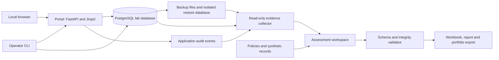

# Product Requirements Document

## Cybersecurity Risk & IT General Controls Assessment

**Independent portfolio project | Simulated Malaysian financial institution**

| Document field | Value |
| --- | --- |
| Document ID | PRD-CYBER-001 |
| Version | 1.0 |
| Date | 24 September 2026 |
| Product owner | Faris |
| Status | Proposed implementation baseline; implementation has not started |
| Primary audience | Project owner, implementing developer, assessment reviewer, portfolio reader |
| Working directory | `C:\Users\TUF\OneDrive\Projects\CybersecurityProject` |
| Delivery model | Local lab, assessment toolkit, and reviewable portfolio artifacts |
| Language | English for interfaces, documentation, reports, and presentations |

**[Certain] Document meaning:** This PRD specifies work to build and verify. Numbers in requirements are delivery targets or synthetic dataset sizes, not completed achievements. No implementation, audit opinion, regulatory certification, client engagement, or hiring outcome is claimed.

**[Likely] Design position:** The strongest outcome for the supplied Associate - Digital Trust and Cybersecurity role is a reproducible assessment with defensible evidence, practical recommendations, and understandable reporting. Software supports that assessment.

**Requirement language:** MUST denotes a release requirement. SHOULD denotes a recommended improvement. MAY denotes an optional capability. All architecture choices below are explicit proposed defaults, so implementation can proceed without unresolved product decisions. Changes follow Section 23.

## Contents

1. [Purpose and problem](#1-purpose-and-problem)
2. [Objectives and success measures](#2-objectives-and-success-measures)
3. [Users and responsibilities](#3-users-and-responsibilities)
4. [Fictional business and assessment boundary](#4-fictional-business-and-assessment-boundary)
5. [Scope and priorities](#5-scope-and-priorities)
6. [User journeys](#6-user-journeys)
7. [Architecture and technology decisions](#7-architecture-and-technology-decisions)
8. [Functional requirements](#8-functional-requirements)
9. [Control catalogue](#9-control-catalogue)
10. [Framework and regulatory mapping](#10-framework-and-regulatory-mapping)
11. [Assessment methodology](#11-assessment-methodology)
12. [Risk scoring and remediation](#12-risk-scoring-and-remediation)
13. [Data model and integrity rules](#13-data-model-and-integrity-rules)
14. [Synthetic data and failure scenarios](#14-synthetic-data-and-failure-scenarios)
15. [Interfaces and command contracts](#15-interfaces-and-command-contracts)
16. [Evidence management](#16-evidence-management)
17. [Reporting and portfolio deliverables](#17-reporting-and-portfolio-deliverables)
18. [Nonfunctional requirements](#18-nonfunctional-requirements)
19. [Verification and acceptance tests](#19-verification-and-acceptance-tests)
20. [Repository structure and development workflow](#20-repository-structure-and-development-workflow)
21. [Delivery phases and dependencies](#21-delivery-phases-and-dependencies)
22. [Risks, assumptions, and mitigations](#22-risks-assumptions-and-mitigations)
23. [Decision register and change control](#23-decision-register-and-change-control)
24. [Definition of done and handoff](#24-definition-of-done-and-handoff)
25. [References and verification status](#25-references-and-verification-status)
26. [Glossary](#26-glossary)

## 1. Purpose and problem

### 1.1 Product purpose

Build a repeatable, evidence-based cybersecurity and IT general controls assessment of a fictional financial institution. Demonstrate the complete chain:

> Business objective → risk → control → test → evidence → conclusion → finding → recommendation → remediation → retest → management communication.

The deliverable combines a small functioning lab, structured assessment records, and a professional reporting package. A reviewer must be able to reproduce representative tests and understand the limits of each conclusion.

### 1.2 Role alignment

**[Certain] Basis:** The user-supplied job description emphasizes technology risk, independent assessments, IT general controls, relevant recommendations, engagement delivery, and English communication. PwC's public service description also covers IT risks and system controls [R1]. This project is independently designed and is not a PwC assignment or endorsed methodology.

| Capability from the supplied role | Required project demonstration |
| --- | --- |
| Understand a client's environment | Business profile, asset register, data flow, scope, and impact assumptions |
| Assess technology and cybersecurity controls | Twenty documented controls with design and operating conclusions |
| Understand frameworks and local requirements | NIST mapping plus selected, sourced BNM RMiT mappings |
| Apply critical thinking | Sample rationale, conflicting evidence handling, limitations, and risk reasoning |
| Recommend practical improvements | Actions prioritized by risk, dependencies, effort, and business constraints |
| Manage deliverables | Milestones, evidence requests, issue tracking, and review notes |
| Communicate in English | Executive report, technical workpapers, and presentation |

### 1.3 Product boundaries

The project MUST describe itself as an independent simulation. It MUST distinguish technical testing performed by the developer from fictional management approvals and generated historical records. The same person may build and assess the lab, but MUST disclose the absence of independent assurance.

## 2. Objectives and success measures

| ID | Objective | Release measure |
| --- | --- | --- |
| OBJ-01 | Reproducible lab | Fresh setup, seed, collection, assessment validation, and export complete using documented commands |
| OBJ-02 | Substantive assessment | All 20 controls have documented scope, criteria, procedures, evidence references, and separate design/operation conclusions |
| OBJ-03 | Regulatory literacy | All controls have a NIST category mapping; selected RMiT mappings include verified references, rationale, coverage limits, and applicability |
| OBJ-04 | Evidence traceability | Every material conclusion and finding resolves to existing, hash-verified evidence or an explicit evidence limitation |
| OBJ-05 | Demonstrated judgment | Six planned exception scenarios are investigated; actual findings follow observed results rather than the scenario answer key |
| OBJ-06 | Remediation proof | S01, S03, S05, and S06 have implemented fixes, fresh tests, and before/after evidence |
| OBJ-07 | Business communication | Completed workbook, executive report, presentation, and remediation roadmap reconcile to one assessment snapshot |
| OBJ-08 | Honest portfolio | Every resume claim links to a delivered artifact and states the simulation context |

Measurement rules:

- Control completion = controls with completed, reviewed workpapers / 20. Completion does not mean effectiveness.
- Scenario detection = investigated scenarios with correctly supported conclusions / 6. This is a lab measure, not a production detection rate.
- Verified closure = findings closed after accepted retest / findings due for retest. Show numerator and denominator.
- Report any unresolved or untested controls explicitly. Never convert missing evidence into a pass.
- Do not produce a single regulatory compliance percentage or a hiring-probability score.

## 3. Users and responsibilities

| Role | Responsibilities | Access / implementation |
| --- | --- | --- |
| Project owner / assessor | Define scope, gather evidence, write findings, and approve portfolio content | Local CLI and canonical assessment files |
| Simulated system administrator | Provision/deactivate lab accounts and maintain configuration | Authenticated lab admin interface |
| Simulated change approver | Review changes and record approval/rejection | Lab change interface; cannot approve own requests |
| Simulated staff user | Create and read permitted synthetic service requests | Restricted portal |
| Simulated read-only user | Read authorized service requests | No mutation privileges |
| Reviewer | Examine workpapers, challenge conclusions, and reproduce selected tests | Sanitized export; local reproduction instructions |
| Portfolio reader | Understand project purpose, evidence, and lessons | README, sanitized report, presentation |

One human may operate multiple fictional accounts. Record this as role simulation, not actual teamwork or independent review. If no external reviewer participates, use `self_reviewed` and record limitations; never fabricate reviewer names or approvals.

## 4. Fictional business and assessment boundary

### 4.1 Business scenario

**[Likely] Proposed scenario:** Use the name **Example Bank Lab**, a wholly fictional Malaysian licensed commercial bank scenario. The assessed service is an internal customer-service request portal. The portal supports request creation, assignment, status updates, and read-only review; it does not execute payments or maintain real bank accounts.

Business objectives defined for the exercise:

- Keep customer-service requests available to authorized staff.
- Prevent inappropriate access and unauthorized changes to request records.
- Preserve an accountable record of administrative and business actions.
- Restore the service and its data after a local failure.
- Explain residual risks and improvement priorities to fictional management.

### 4.2 System boundary

In scope: portal application, local PostgreSQL database, application identities, change records, lab deployment scripts, backup/restore process, application audit events, selected dependencies, and synthetic governance documents.

Assessment inputs also include two fictional supplier records and a fictional organization chart. These are documentary exercises; no supplier systems are connected or assessed.

Out of scope: actual banking infrastructure, customer money, payment rails, employer information, production financial statements, physical security testing, full enterprise resilience, and legal certification.

### 4.3 Assessment period and time

- Historical fixture window: **1–30 August 2026**, explicitly generated and synthetic.
- Actual execution window: recorded when tests are run; never backdate collection or execution.
- Retest window: recorded separately after remediation.
- Canonical timestamps: ISO 8601 UTC; human-facing reports show GMT+8 and the corresponding timezone.
- Historical fixture coverage is not evidence of 30 days of real operation.

### 4.4 Project-specific policies

These thresholds are exercise criteria, not regulatory requirements:

| Policy ID | Exercise criterion |
| --- | --- |
| POL-01 | Access requires a named owner and approval before activation; least privilege follows a versioned role matrix |
| POL-02 | Leaver access is disabled within 24 hours of the recorded termination; active sessions are invalidated on deactivation |
| POL-03 | Privileged portal actions require completed MFA; quarterly access reviews are the fictional policy frequency |
| POL-04 | Normal changes require separate requester/approver identities, test evidence, and a rollback plan before deployment |
| POL-05 | Emergency changes require a reason and retrospective review within two business days, using a documented lab calendar |
| POL-06 | Backup after each demonstration transaction batch; verify each created backup and perform an isolated restoration exercise |
| POL-07 | Lab recovery targets: RTO no more than 30 minutes; RPO no more than 24 hours, measured using real timestamps |
| POL-08 | Audit authentication, role changes, deactivation, service-request updates, change decisions, and backup/restore actions |
| POL-09 | Five failed logins for one account in five minutes produce an alert; an administrative role change also produces an alert |
| POL-10 | Patch and risk-action deadlines use the project risk matrix; policy exceptions require a rationale, owner, and review date |

These policies MUST be versioned before testing. An observed policy breach is not automatically a breach of a mapped regulation.

## 5. Scope and priorities

### 5.1 Must deliver for version 1

- Small local portal with authentication, roles, service requests, and change workflow.
- Secure default configuration and separately activated, bounded exception scenarios.
- Deterministic synthetic records, business documents, and a scenario manifest.
- Assessment CLI with validated structured records, evidence registration, integrity checks, and exports.
- Twenty-control assessment covering six domains.
- NIST Current/Target assessment and selected RMiT gap analysis.
- Six exception scenarios, at least four implemented remediation/retest paths, and an incident tabletop.
- Executive report, Excel workbook, presentation, reproducibility instructions, and evidence-backed resume bullets.

### 5.2 Should deliver after the required work

- A read-only assessment dashboard generated from the same validated snapshot.
- Automated scheduled backup demonstration with observed history.
- Review by another person with recorded comments and responses.
- Additional verified RMiT mappings where they improve the assessment.

### 5.3 Explicitly deferred

Multi-tenant GRC software, public cloud hosting, enterprise SSO, Active Directory, a full SIEM, AI-generated risk judgments, attack tooling, a mobile app, continuous compliance monitoring, full ISO certification assessment, and broad coverage of every Malaysian regulator.

No public deployment or GitHub publication is required to complete the local project. Distribution decisions are separate from building and verifying artifacts.

## 6. User journeys

### J-01 — Establish an engagement

The assessor selects the business scenario, documents scope and exclusions, registers assets and simulated stakeholders, versions policies, records framework sources, and sets the assessment period. Validation rejects a missing scope or unidentified criteria source.

### J-02 — Build and observe the environment

The operator starts the secure lab, seeds data, verifies normal access, and runs a selected exception in a disposable scenario environment. The assessor collects actual exports, logs, configuration, and execution records. Synthetic history and observed runtime evidence remain distinguishable.

### J-03 — Test and conclude

The assessor defines a population, selects records using the documented rule, records procedures and outcomes, and links evidence. The reviewer can follow those references. Missing evidence generates a limitation, not a successful conclusion.

### J-04 — Recommend and repair

The assessor writes a finding with criteria, condition, cause, consequence, and recommendation. A remediation action records the chosen fix, tradeoffs, fictional owner role, effort, and due date. A fresh retest either verifies closure or returns the finding to open work.

### J-05 — Present and reproduce

The assessor exports the validated snapshot, explains the top risks in English, demonstrates one complete finding-to-retest chain, and provides commands for a reviewer to reproduce it. Sanitized materials never imply a real client engagement.

## 7. Architecture and technology decisions

### 7.1 Component design



The assessed lab and the assessment workspace MUST have separate storage. The portal MUST NOT be able to rewrite assessment conclusions, evidence manifests, or published reports. Collection credentials MUST be read-only; migrations, scenario injection, and remediation use separate operator credentials.

### 7.2 Proposed stack

| Area | Default | Reason / tradeoff |
| --- | --- | --- |
| Runtime | Python 3.12 | One language for app, tests, collection, and exports; pin tested patch version in Phase 1 |
| Lab API and pages | FastAPI, Jinja2, minimal CSS | Keeps attention on controls; no separate JavaScript frontend build |
| Database | PostgreSQL 17, SQLAlchemy, Alembic | Relational records, privileges, migrations, and realistic restore tests |
| Authentication | Established Argon2 and TOTP libraries; opaque server-side sessions | Demonstrates authentication controls without inventing cryptography |
| Local orchestration | Docker Compose | Repeatable services, networks, and volumes [R7] |
| Assessment records | YAML with Pydantic validation; JSON manifests | Human-reviewable, versionable sources with explicit schemas |
| CLI | Python standard-library argparse | Avoids an unnecessary CLI framework |
| Workbook | openpyxl | One-way XLSX generation from validated records |
| Reports | Markdown and self-contained HTML; browser print to PDF | Editable source and readable distribution without a document platform |
| Presentation | Markdown slide script and PDF slides | Content first; PPTX is optional |
| Verification | pytest, FastAPI test client, browser checks, Ruff | Behavior tests, record integrity, and reproducible quality gates |

Versions above are design selections, not claims about the newest releases. Phase 1 MUST resolve compatible dependency versions, pin the installation and container inputs, and record exact versions. If a selected version cannot meet security or compatibility requirements, record an ADR and update this PRD.

### 7.3 Storage and environment separation

- Expose the portal only on `127.0.0.1:8000` by default. No database host port is required.
- Keep PostgreSQL data in Docker volumes, not a OneDrive-synchronized database directory.
- Create a dedicated Compose project and volume prefix per scenario run.
- Run recovery into a separate database/container; never overwrite the source database during a restore test.
- Store local runtime secrets outside tracked files. The app container receives only its required secrets.
- Keep raw evidence and backups in an ignored runtime directory. Export reviewed, sanitized evidence to a separate distribution directory.
- Do not claim different containers on one laptop establish physical separation or a disaster recovery site.

## 8. Functional requirements

All FR requirements are MUST for version 1 unless explicitly marked SHOULD. Acceptance tests are defined in Section 19.

| ID | Requirement | Acceptance |
| --- | --- | --- |
| FR-01 | Initialize an engagement with business context, scope, periods, assets, policies, owners, source versions, and exclusions | AT-01 |
| FR-02 | Seed deterministic synthetic populations; the same seed yields identical business records apart from explicitly variable run metadata | AT-02 |
| FR-03 | Authenticate users; enforce server-side roles, account state, session expiration, and privileged MFA on every protected action | AT-03, AT-04 |
| FR-04 | Create, list, view, and update service requests according to ownership and role; preserve action history | AT-03 |
| FR-05 | Record access requests, approvals, role changes, deactivations, and access-review decisions | AT-05 |
| FR-06 | Provide change request, testing, approval, deployment-record, rollback-record, and emergency-review workflows | AT-06 |
| FR-07 | Produce attributable, structured audit events and local monitoring alerts | AT-07 |
| FR-08 | Create database backups, verify integrity, restore to isolation, and measure recovery against stated targets | AT-08 |
| FR-09 | Collect read-only evidence, register provenance and hashes, and preserve original and sanitized artifact relationships | AT-09 |
| FR-10 | Maintain the control catalogue and mapping register; reject unsupported or broken framework references | AT-10 |
| FR-11 | Capture populations, samples, procedures, evidence, exceptions, and separate design/operating conclusions | AT-11 |
| FR-12 | Maintain risk records and findings with explicit criteria, business implications, rating rationale, and limitations | AT-12 |
| FR-13 | Track remediation, proposed residual risk, fresh retest results, and guarded closure transitions | AT-13 |
| FR-14 | Execute bounded baseline scenarios and preserve their results separately from remediated results | AT-14 |
| FR-15 | Generate consistent workbook, report, roadmap, and presentation inputs from one frozen snapshot | AT-15 |
| FR-16 | Produce an allowlisted sanitized distribution bundle with a manifest and claim-to-evidence register | AT-16 |
| FR-17 | Manage evidence requests, milestone progress, blockers, review comments, and decisions | AT-17 |
| FR-18 | Fail clearly on missing services, invalid records, tampered evidence, unsafe paths, or partial exports | AT-18 |

The application MUST record workflow decisions. It MUST NOT execute arbitrary shell commands supplied through forms, serve arbitrary local files, or expose a web endpoint for enabling scenarios.

## 9. Control catalogue

Each row is a project-authored control objective and minimum test, not a quotation or complete restatement of a framework. The NIST columns are initial category-level alignment; Section 10 defines the mapping requirements. Every control requires a workpaper using Section 11.

| ID | Domain / control | Minimum procedure and evidence | NIST category |
| --- | --- | --- | --- |
| GOV-01 | Business scope, asset ownership, and policies | Reconcile deployed components to asset/data-flow records; inspect named owners and versioned policy decisions | GV.OC, GV.RR, ID.AM |
| GOV-02 | Risk identification and review | Walk through service risks; inspect rating reasoning, action owners, review dates, and documented challenge | GV.RM, ID.RA |
| GOV-03 | Supplier risk and responsibility | Review both fictional suppliers for criticality, due diligence, service expectations, data responsibilities, and gaps | GV.SC |
| IAM-01 | Joiner provisioning | Inspect all joiner records; compare approved roles and dates with actual accounts | PR.AA |
| IAM-02 | Leaver deactivation | Reconcile all leavers to accounts; test login and an existing session after deactivation | PR.AA |
| IAM-03 | Least privilege and authorization | Compare all privileged accounts to the role matrix; attempt prohibited actions and cross-user request access | PR.AA |
| IAM-04 | Privileged authentication | Verify MFA enrollment and enforcement; test direct privileged requests, stale sessions, and reused/invalid codes | PR.AA |
| IAM-05 | Periodic access review | Reconcile a complete account export to a simulated review record; trace exceptions to action evidence | PR.AA |
| CHG-01 | Change authorization and separation | Inspect every change's requester, approver, timing, and deployment decision; test self-approval rejection | PR.AA, PR.PS |
| CHG-02 | Predeployment testing | Trace deployed changes to version-specific test results and acceptance decisions; investigate missing or mismatched evidence | PR.PS |
| CHG-03 | Release and rollback | Compare recorded deployment versions to actual running versions; perform a controlled rollback and smoke test | PR.PS, PR.IR |
| CHG-04 | Emergency change follow-up | Inspect both emergency changes for reason, authority, implementation evidence, and timely retrospective review | PR.PS |
| OPS-01 | Backup execution and exception handling | Reconcile scheduled fixture jobs to outcomes; create an actual backup and investigate a failed/corrupt artifact | PR.DS |
| OPS-02 | Restore integrity | Restore a verified backup into isolation; compare business records and test application behavior | PR.DS, RC.RP |
| OPS-03 | Audit logging and review | Perform the event coverage matrix; reconcile actions to events and investigate omissions; inspect review records | PR.PS, DE.CM |
| OPS-04 | Dependency risk and patch management | Inventory installed packages, record scan scope/freshness, assess results, and trace a selected treatment decision | ID.RA, PR.PS |
| IR-01 | Alert generation and triage | Trigger project login and role-change alerts; verify threshold, deduplication, attribution, and triage records | DE.CM, DE.AE |
| IR-02 | Incident handling | Execute a suspicious-access tabletop; document evidence, severity, containment decision, escalation, and lessons | RS.MA, RS.AN |
| DR-01 | Recovery planning | Inspect dependencies, recovery sequence, credentials access, RTO/RPO assumptions, and activation criteria | PR.IR, RC.RP |
| DR-02 | Recovery exercise and improvement | Run the recovery exercise; record timing/data loss and update the plan based on observed failures | RC.RP, ID.IM |

Coverage total: **3 governance + 5 access + 4 change + 4 operations + 2 incident + 2 recovery = 20 controls.**

## 10. Framework and regulatory mapping

### 10.1 Source handling

**[Certain] Source facts:** NIST publishes CSF 2.0 and Current/Target Profile guidance [R2–R4]. BNM's revised RMiT publication is dated 28 November 2025, with an FAQ updated 1 July 2026 linked from its publication page [R5–R6].

The mapping register MUST record framework/version, source URL, document date, retrieval date, paragraph/category, page where applicable, a short original summary, rationale, assessment coverage, and verification status. Store a local source hash when a permitted reference copy is retained. Do not redistribute licensed source material in the portfolio.

### 10.2 NIST use

Use the categories listed in Section 9 as the initial mapping. For each mapped outcome, describe the current evidence, target practice, gap, priority, and action. Optional subcategory mappings must be verified against the official source before use. Multiple controls may support one outcome; a control may support multiple outcomes. Do not count duplicated mappings as extra tested controls.

The profile covers the selected service boundary only. Do not equate a project scoring scale with NIST Tiers or claim NIST certification.

### 10.3 Initial RMiT reference set

**[Certain] Reference locations checked against the official 2025 PDF [R6].** Pages below use the PDF's displayed document page numbers. The exercise tests selected aspects; these are not equivalence mappings.

| Paragraph | Page | Topic pointer | Project controls |
| --- | --- | --- | --- |
| 10.8 | 15 | System testing | CHG-02 |
| 10.11 | 15 | Change approval and contingency | CHG-01, CHG-03 |
| 10.44 | 22 | Backup and restoration | OPS-01, OPS-02 |
| 10.47 | 22–23 | Supplier due diligence | GOV-03 |
| 10.53–10.54 | 25 | Access policy and principles | IAM-01, IAM-02, IAM-03 |
| 10.55 | 25 | Strong MFA | IAM-04 |
| 10.56 | 25 | Access matrix | IAM-03, IAM-05 |
| 10.57 | 26 | Access monitoring and logs | OPS-03, IR-01 |

The fictional licensed-bank scenario establishes the exercise's applicability assumption. Controls without a verified RMiT link remain NIST/project-policy assessments; do not invent paragraph numbers to fill cells.

### 10.4 Mandatory coverage limitations

- TOTP demonstration alone MUST NOT be treated as proof of the social-engineering resistance addressed by paragraph 10.55.
- Short lab log history MUST NOT be treated as evidence of the three-year retention addressed by paragraph 10.57.
- A local restore MUST NOT be represented as a full enterprise backup/resilience assessment.
- Separate assessment answers are required for meeting the project criterion and addressing the broader mapped requirement.
- ISO/IEC 27001, NACSA, Securities Commission, and MCMC coverage is outside the selected assessment. The report must explain that scope choice without claiming those regimes cannot apply to a real organization.

Use mapping statuses `verified_reference`, `unverified_reference`, or `not_mapped`. Use coverage conclusions `supported_for_tested_aspect`, `gap_identified`, `not_assessed`, or `not_applicable_with_rationale`. An unverified mapping blocks final publication of the affected regulatory claim.

## 11. Assessment methodology

### 11.1 Work sequence

1. Define business objective, assets, risk, criteria, period, and control owner.
2. Obtain and register the relevant policy, population, configuration, and event evidence.
3. Assess whether the control design could address the stated risk.
4. Define test procedures and select a sample before recording results.
5. Execute tests and capture actual outcomes, including negative tests.
6. Reconcile contradictory evidence and evaluate exceptions.
7. Conclude separately on design and operation, limiting each conclusion to the evidence.
8. Raise findings and recommendations, then perform documented quality review.
9. Freeze the baseline; implement selected fixes and create fresh retest workpapers.

### 11.2 Required workpaper fields

Each workpaper MUST include control ID/version, risk IDs, applicable criteria, procedure version, test type, test period, population source/hash/count, selected record IDs, selection rationale, expected behavior, actual results, evidence IDs, exceptions, limitations, preparer, review mode, review comments, and timestamps.

Design statuses: `adequate`, `partially_adequate`, `inadequate`, `not_assessed`, `not_applicable`.

Operating statuses: `effective_in_tested_scope`, `exceptions_identified`, `not_operated`, `insufficient_evidence`, `not_tested`, `not_applicable`.

An automated check may produce observations. Only an explicit recorded assessor decision sets the conclusion. A technically successful script is not an automatic control pass.

### 11.3 Population and sample rules

- Population of 25 or fewer items: test every item, unless an exclusion is recorded and justified.
- Larger population: test every high-risk/exception item plus 10 additional items selected using a recorded deterministic random seed, capped at the remaining population size.
- Always test all leavers, privileged accounts, and emergency changes in the defined dataset.
- Record the population query, time boundary, count, exclusions, sample seed, and exact sample IDs. Snapshot the population before testing.
- The method is judgmental educational sampling; it does not provide statistical assurance.
- For configuration controls, inspect the relevant configuration and reperform representative allowed and forbidden actions.
- For a control with no event in the period, record `not_operated`; optionally run a walkthrough, clearly labeled as a separate exercise.

### 11.4 Evidence interpretation

Prefer observed behavior plus configuration and record reconciliation over a screenshot alone. A policy establishes intended practice; it does not prove operation. Missing approval documentation supports a documentation/evidence exception, not an invented assertion that no approval ever occurred.

Document alternative explanations and compensating controls. Retain conflicting evidence and explain the resolution. If evidence is missing or unreliable, narrow the conclusion instead of filling the gap with assumptions.

### 11.5 Review and independence

At minimum, conduct a separate self-review pass after preparing workpapers. Record comments and corrections. A second person is optional; label external review only if it actually occurred. The report MUST identify that the developer also assessed the lab.

## 12. Risk scoring and remediation

### 12.1 Rating model

Use a project-defined 5 × 5 likelihood/impact matrix. It is an ordering aid, not a probability estimate, financial-loss model, or regulatory scoring method.

| Score | Likelihood anchor within the scenario | Impact anchor within the business scenario |
| --- | --- | --- |
| 1 | Requires exceptional conditions; effective barriers demonstrated | Isolated inconvenience; no material service or data consequence |
| 2 | Uncommon path with several prerequisites | Limited rework or short disruption to a small group |
| 3 | Plausible path with partial barriers | Service degradation, incorrect records, or meaningful recovery work |
| 4 | Readily repeatable with weak barriers | Significant unauthorized access or disruption to the assessed service |
| 5 | Directly reproducible with minimal prerequisites or recurring observations | Widespread sensitive-data compromise or prolonged loss of a critical service in the scenario |

Rating = likelihood × impact. Low: 1–4; Medium: 5–9; High: 10–16; Critical: 17–25. Record a short rationale for both inputs. Financial loss values must not be invented.

For each risk, distinguish inherent risk, current residual risk supported by observed controls, and proposed residual risk after planned action. Proposed residual risk remains an estimate until the relevant retest is completed. An effective lab fix may leave broader regulatory gaps.

### 12.2 Finding contract

Each finding MUST contain: ID, title, affected service/control IDs, criteria reference, observed condition, evidence references, confirmed or hypothesized cause, business consequence, rating/rationale, recommendation, alternatives/tradeoff, fictional owner role, effort estimate, target date, status, and limitations.

Root cause must be labeled `confirmed`, `hypothesis`, or `unknown`. Do not invent management statements or client agreement.

### 12.3 Remediation priorities

| Priority | Default treatment target from finding date | Required handling |
| --- | --- | --- |
| Critical | Containment in 1 day; corrective plan in 7 days | Track immediate exposure and blockers |
| High | 14 calendar days | Implement or document an exception with a review date |
| Medium | 30 calendar days | Schedule by dependencies and effort |
| Low | 60 calendar days | Track improvement or justified deferral |

These are exercise service targets. They do not describe statutory deadlines. A simulated risk acceptance requires a rationale, accountable role, expiry/review date, and statement that no real executive accepted the risk.

### 12.4 State transitions

Finding lifecycle: `draft → reviewed → open → in_progress → ready_for_retest → closed_verified`.

Failed retest returns to `in_progress`. `risk_accepted` is a separate unresolved-risk disposition, not verified closure. `duplicate` requires a surviving finding ID. Transition to `closed_verified` requires fresh evidence, an accepted retest, and no outstanding failure of the closure criteria. Preserve all prior findings, ratings, and test runs.

## 13. Data model and integrity rules

### 13.1 Lab entities

| Entity | Required fields / relationships |
| --- | --- |
| User | ID, synthetic name/email, status, role, manager reference, join/leave dates; secret authentication fields excluded from exports |
| Session | Random opaque identifier stored as a hash, user ID, issued/expiry times, MFA state, revocation timestamp |
| ServiceRequest | ID, owner, assigned staff, category, synthetic description, status, created/updated timestamps |
| AccessRequest | ID, user, requested role, requester/approver, decision, timestamps, linked account change |
| AccessReview | ID, review period, population snapshot, reviewer role, per-account decision, action references |
| ChangeRecord | ID, requester, normal/emergency type, version reference, test evidence, approver, decisions, deployment and rollback records |
| AuditEvent | ID, run ID, actor, action, object, result, timestamp, correlation ID, permitted contextual details |
| Alert / Incident | ID, related event IDs, rule/version, severity, status, triage/containment/escalation records |
| BackupRun | ID, run ID, start/end times, artifact path/hash, status, dataset reference, validation results |

Application role permissions are enforced server-side, including object-level access. Database migrations and constraints MUST enforce primary keys, unique identifiers, required references, and valid state values.

### 13.2 Assessment entities

| Entity | Required fields / relationships |
| --- | --- |
| Engagement | ID, version, scope, organization assumptions, periods, asset IDs, policies, source-register IDs |
| Asset | ID, type, owner role, business process, classification, criticality, dependencies |
| Source / Mapping | ID, version/date/URL, reference locator, verified status, rationale, control IDs, coverage limitations |
| Control | Stable ID, version, objective, domain, risk IDs, owner role, frequency, procedure and criteria references |
| Evidence | ID, path, SHA-256, size, media type, collector, collection time, source period, run ID, provenance type, sensitivity, parent evidence ID |
| TestRun / Workpaper | ID, control/version, test type, frozen population/sample, actual results, evidence IDs, conclusions, review records |
| Risk / Finding | IDs, affected assets/controls, evidence and test IDs, criteria, narrative, ratings, status |
| Action / Retest | IDs, finding ID, owner role, target date, fix reference, closure criteria, new test/evidence IDs, decision |
| EvidenceRequest | ID, requested evidence, simulated provider role, due date, status, response/evidence IDs, blocker |
| ReviewComment | ID, artifact/version, comment, reviewer identity or self-review marker, resolution, timestamps |
| ExportSnapshot | ID, source hashes, selected baseline/retest IDs, generator version, creation time, artifact list/hashes |

### 13.3 Invariants

- Every record includes `schema_version`; unknown versions fail validation.
- IDs are unique within their entity type, references exist, and evidence paths remain inside the allowed workspace.
- Evidence provenance is one of `observed_lab`, `synthetic_record`, `authored_policy`, or `external_reference`.
- Conclusions and reports MUST retain provenance distinctions.
- Closure timestamps cannot precede fix/retest timestamps; an observation cannot predate its real execution.
- Content revisions create a new version; finalized baseline records are never silently overwritten.
- A manifest hash detects modification; it does not prove authenticity or provide independently immutable storage.
- CSV/XLSX text fields beginning with spreadsheet formula characters must be escaped as text.
- Export formats are generated outputs, not a second editable source of truth. XLSX import is out of scope.

## 14. Synthetic data and failure scenarios

### 14.1 Seeded populations

| Population | Required baseline dataset |
| --- | --- |
| Staff identities | 24 total: 2 administrators, 4 change approvers, 12 staff, 6 read-only users; 3 of the 24 have terminated employment status |
| Joiner events | 6, referring to identities within the 24-user population |
| Service requests | 50 fictional records with no real customer identifiers |
| Access review | 1 synthetic review covering all 24 identities |
| Changes | 12: 10 normal and 2 emergency changes |
| Backup job history | 8 synthetic job records; actual executions are collected separately |
| Incidents | 4 fictional historical records; tabletop execution is a separate observed exercise |
| Suppliers | 2 fictional documentary cases, including one incomplete due-diligence pack |

Names MUST be obviously fictional; emails use reserved example domains. Generated event IDs, time rules, fixture seed, and generator version MUST be recorded. Supplier and governance exceptions are analyzed on their own merits and do not change the six mandatory technical scenario definitions.

### 14.2 Required scenarios

| ID | Deliberate condition | Expected investigation | Required treatment |
| --- | --- | --- | --- |
| S01 | One terminated staff identity retains access and an active session | Reconcile leaver records, attempt permitted login/session actions, identify timing breach | Deactivate and revoke sessions; verify old and new access fail |
| S02 | A staff account receives an unjustified admin role | Reconcile role matrix, approval record, and actual authorization | Document finding and action; implemented remediation SHOULD follow |
| S03 | Privileged action accepts a password-only session in the scenario environment | Test direct request enforcement, not only visibility of the MFA page | Enforce MFA and invalidate weak privileged sessions; retest negative and positive paths |
| S04 | A deployed change has requester-equals-approver and missing test evidence | Reconcile change workflow and running version | Document finding and action; implemented remediation SHOULD follow |
| S05 | A job reports backup success but its backup artifact is corrupt | Validate hash/restore outcome and reconcile job status to observed recovery failure | Correct validation and create/restore a valid backup; keep the failed original |
| S06 | An administrative action omits its required audit event | Reconcile a known action sequence to the event coverage matrix | Restore logging; reperform action and verify event and alert behavior |

The secure default application MUST reject these weaknesses. A scenario runner may reproduce defined failures only within its uniquely named disposable lab resources. It MUST record the exact injected condition and refuse arbitrary targets. Do not expose a general-purpose vulnerability toggle through the portal.

Run each scenario in an isolated fresh state, or provide an explicit dependency/reset manifest for a combined run. Freeze the baseline run before remediation. Retest results use new IDs and evidence paths. A clean default environment is not evidence that a scenario finding was repaired.

An expected-result manifest belongs to the test oracle. Assessment conclusions MUST reference observations; copying the answer key is not a valid test. Unexpected failure to reproduce a scenario must be investigated, not converted to a fabricated finding.

### 14.3 Incident and recovery exercise

Execute a suspicious privileged-access tabletop using synthetic events, followed by an isolated restoration exercise. Record a timeline, decisions, evidence, who was role-played, containment actions, service validation, and lessons. No emails, regulator notifications, or messages to third parties are sent; communications remain labeled drafts.

## 15. Interfaces and command contracts

### 15.1 Portal screens

| Screen | Required behavior |
| --- | --- |
| Login / MFA | Clear validation errors, generic authentication failures, no privileged access before MFA completion |
| Service requests | Role-appropriate list/detail/edit actions, empty states, validation feedback, and audit history |
| Access administration | Accounts, role matrix, provisioning/deactivation, request decisions, and review records |
| Change management | Request details, required artifacts, decisions, state history, deployment/rollback records |
| Monitoring | Read-only event and alert views for permitted operators; filter by run/time/action |
| Run information | Persistent simulation banner, current scenario/run ID, environment state, and data provenance labels |

Use readable typography, consistent spacing, labeled inputs, keyboard access, and status text in addition to color. Do not add decorative charts that obscure missing evidence or unresolved findings.

The version 1 permission matrix is:

| Action | Administrator | Change approver | Staff | Read-only |
| --- | --- | --- | --- | --- |
| Read service requests | All | All | Own or assigned | All |
| Create service request | Yes | Yes | Yes | No |
| Edit or assign service request | All | No | Own or assigned; no reassignment | No |
| Submit access/change request | Yes | Yes | Yes | No |
| Approve access/change request | No | Yes, except own requests | No | No |
| Apply approved account/role change | Yes, except own privilege elevation | No | No | No |
| Read audit events and alerts | Yes | Yes | No | No |
| Alter audit history | No | No | No | No |

Accounts have one role at a time; role changes invalidate existing sessions. Provisioning and role changes require an approved access request. Deactivation is immediately available to the administrator and records the reason and actor. Initial bootstrap uses a local operator command, is logged, and cannot be invoked from the browser. All listed privileges are subject to account state, object scope, and privileged-MFA checks.

Service request states are `open → in_progress → resolved`; reopening a resolved request requires a reason and an audit event. Changes become read-only after a deployment record is finalized, except for appended rollback and retrospective-review records. A rejected change must be revised and resubmitted with its previous decisions preserved. No UI state change alone proves an actual deployment or rollback: operator scripts record the observed running version and smoke-test results.

Privileged actions include account administration, access/change approval, and access to audit/alert views. Sessions expire after 30 minutes without activity or eight hours from login, whichever comes first. Authentication attempts are throttled after five failures per account in five minutes with a temporary five-minute block; the corresponding alert still records the threshold crossing. These are project defaults, not regulatory thresholds.

### 15.2 Endpoint families

Define and document exact request/response schemas during Phase 2. Required endpoint families are `/auth`, `/requests`, `/admin/users`, `/access-requests`, `/access-reviews`, `/changes`, `/events`, and `/alerts`.

- Public endpoints are limited to login/MFA initiation and minimal liveness. Readiness MUST reveal no credentials or internal database details.
- Unauthenticated API requests return 401; unauthorized actions return 403, or 404 for inaccessible object IDs when needed to avoid object disclosure.
- Invalid payloads return 422 with safe field errors; invalid state transitions return 409.
- Mutation requires CSRF protection when using cookie sessions.
- Collection uses a read-only database role and permitted log files; no evidence-upload API is required.

### 15.3 CLI contract

The commands below are required future interfaces, not commands that already exist. The package name is `cyber_assess`. All commands emit clear human output and MAY provide `--json` output.

```text
python -m cyber_assess doctor
python -m cyber_assess init --engagement ENG-001
python -m cyber_assess lab up
python -m cyber_assess lab seed --seed 42
python -m cyber_assess scenario run --id S01
python -m cyber_assess scenario remediate --id S01 --baseline-run RUN-001
python -m cyber_assess scenario retest --id S01 --baseline-run RUN-001
python -m cyber_assess backup create --run RUN-001
python -m cyber_assess backup restore-test --backup BACKUP-001
python -m cyber_assess evidence collect --run RUN-001
python -m cyber_assess assess validate --engagement ENG-001
python -m cyber_assess findings validate --engagement ENG-001
python -m cyber_assess snapshot create --engagement ENG-001
python -m cyber_assess export --snapshot SNAP-001 --format all
python -m cyber_assess verify --snapshot SNAP-001
python -m cyber_assess lab stop
```

`doctor` checks runtime, Docker availability, ports, writable directories, configuration, and source prerequisites without printing secrets. `init` must not overwrite an existing engagement. `lab stop` preserves data. A separate reset operation must show exact resource paths/names and require an explicit project-scoped reset flag; it must never delete unrelated files or Docker volumes.

Run, backup, and snapshot IDs shown above are illustrative; commands return the allocated IDs for dependent commands. Remediation and retest commands accept only implemented scenario IDs and a matching baseline run, check ownership of the target resources, and refuse to modify frozen baseline evidence. Retests operate on an explicitly linked remediation environment. Repeated execution must create a new run or return the existing completed result without silently overwriting it.

Exit codes: 0 success, 1 execution failure, 2 invalid input/schema, 3 missing prerequisite, 4 integrity or publication-gate failure. Failed exports must leave no apparently final partial bundle. Commands must identify whether a failure is a lab error or a valid observed control exception.

## 16. Evidence management

### 16.1 Collection and provenance

Collectors MUST record the query or action, actual UTC collection time, source system/run, source period, exact tool version, and file hash. Capture only allowlisted fields; never export passwords, password hashes, MFA seeds, session tokens, or database connection credentials.

Register raw evidence first. A redacted derivative receives a new ID/hash and references its original. Keep an explanation of removed fields. Restrict raw directories to the local user where supported, and do not claim operating-system access restrictions provide independent chain of custody.

### 16.2 Accepted evidence types

CSV/JSON exports, configuration snapshots, structured event records, script output with exit status, version-specific test results, synthetic policies and approvals, diagrams, screenshots with context, backup metadata, and restoration validation results.

Screenshots alone do not satisfy record-completeness or operating-effectiveness claims. Backup files may remain private runtime artifacts; the public package uses sanitized metadata and validated restoration results.

### 16.3 Integrity and finalization

- Verify evidence hashes before workpaper finalization and export.
- Reject missing, changed, duplicate-ID, or out-of-root evidence references.
- Freeze a snapshot of source records, evidence manifest, configuration versions, and test run IDs.
- Preserve original failure evidence through remediation and export.
- Record report-generation time separately from the period assessed.
- Human review remains necessary for plausible but incorrect evidence; schema validation is not truth verification.

### 16.4 Retention and distribution

Keep baseline and retest evidence for the lifetime of the portfolio unless the owner deliberately removes it. Do not perform automatic deletion. A sanitized export may include only allowlisted files whose classifications permit distribution. The raw archive must remain excluded from source control and publishing.

## 17. Reporting and portfolio deliverables

### 17.1 Required artifacts

| ID | Artifact | Format / required content |
| --- | --- | --- |
| DEL-01 | Engagement brief | Markdown/PDF: business profile, scope, assumptions, criteria, stakeholders, timeline, limitations |
| DEL-02 | System context | Diagram plus asset/data inventory and dependency description |
| DEL-03 | Assessment workbook | XLSX generated from canonical records; sheets listed below |
| DEL-04 | Evidence package | Sanitized files, evidence index, hashes, provenance, and reproduction instructions |
| DEL-05 | Executive assessment | Markdown, HTML, and PDF; content structure below |
| DEL-06 | Technical workpapers | Twenty control workpapers with population/sample traceability and review records |
| DEL-07 | Remediation and retest pack | Actions, change references, four required implemented fixes, retests, and residual gaps |
| DEL-08 | Executive presentation | Six to eight slides as PDF with English speaker notes; PPTX optional |
| DEL-09 | Repository handoff | README, setup, testing, architecture, methodology, demonstration, limitations, and source register |
| DEL-10 | Claims register | Draft resume bullets mapped to completed artifacts; unsupported claims remain excluded |

### 17.2 Workbook sheets

`Read_Me`, `Scope`, `Assets`, `Controls`, `Mappings`, `Evidence`, `Test_Runs`, `Findings`, `Risks`, `Actions`, `Retests`, `Current_Target`, `Evidence_Requests`, and `Review_Log`.

The workbook MUST include an assessment ID and snapshot ID, filters, frozen header rows, readable widths, wrapped narrative cells, explicit status values, and links or IDs resolving to the export evidence index. Color is supplemental. No macros are required.

### 17.3 Executive report structure

1. Purpose, simulation statement, assessment period, and scope.
2. Business context and service dependencies.
3. Methods, sampling, source documents, and limitations.
4. Assessment results by domain, including incomplete or untested areas.
5. Prioritized findings and business consequences.
6. NIST Current/Target gaps and selected RMiT observations.
7. Remediation roadmap, dependencies, and effort estimates.
8. Retest results and unresolved residual risks.
9. Conclusion limited to the assessed service and evidence.
10. Appendices: source references, evidence index, and control register.

Target six to ten main report pages, excluding appendices. This is an editorial target; completeness and readability take precedence. No client logos, invented client testimonials, audit-firm branding, or certification badges.

### 17.4 Presentation and demonstration

Presentation sequence: business context → scope/method → key risks → one finding/evidence chain → remediation/retest → remaining gaps and roadmap. Include a final limitations slide if needed.

Prepare a ten-minute demo script and a five-minute discussion script. Demonstrate one blocked privileged action, one evidence-linked finding, one isolated restore result, and one report-to-workpaper reference. Record actual demonstration results rather than promising an untested duration.

### 17.5 Resume claim rules

Use action + work + scope + verified method + result/business relevance. Label the entry **Independent Portfolio Project | Simulated Financial Institution**. Only use completed verbs after the corresponding work is verified.

Example future claim: “Assessed access management, change management and IT operations controls in a simulated financial institution, documenting evidence-backed weaknesses and prioritized remediation actions.”

Metrics require a reproducible numerator/denominator or measurement log. “Reduced risk by 80%,” “ensured regulatory compliance,” “led client engagements,” and “achieved 90% hiring probability” are prohibited unless separately established by appropriate real evidence; this lab does not establish them.

## 18. Nonfunctional requirements

| ID | Requirement | Verification |
| --- | --- | --- |
| NFR-01 | Local containment: loopback-only portal binding; no public tunnel; no database host exposure by default | Inspect effective Compose settings and listening endpoints |
| NFR-02 | Secure default: established password hashing, random credentials, server-side authorization, session revocation, CSRF protection, login throttling | Negative/positive authentication and authorization tests |
| NFR-03 | Reproducibility: frozen seed and input versions reproduce business data and control observations | Repeat clean runs; exclude documented variable metadata from comparison |
| NFR-04 | Integrity: no silent evidence replacement or baseline mutation | Tampering, duplicate-ID, and frozen-snapshot tests |
| NFR-05 | Portability: documented Windows PowerShell workflow and Linux CI workflow | Execute both paths before final release |
| NFR-06 | Performance target: default stack starts within 120 seconds after image availability; validated export completes within 60 seconds for 200 evidence records | Benchmark on recorded hardware; log results and bottlenecks |
| NFR-07 | Capacity target: 24 users, 50 service requests, 20 controls, 200 evidence records, and up to 10,000 audit events without truncation | Seeded capacity and export reconciliation test |
| NFR-08 | Reliability: partial service failure, corrupt backup, unavailable scanner feed, and interrupted export produce explicit states and recoverable outputs | Failure-injection tests |
| NFR-09 | Usability: keyboard-operable forms, labeled controls, clear errors, no color-only meaning, readable report tables | Browser and rendered-PDF review |
| NFR-10 | Privacy: synthetic data only; raw secrets never appear in logs or distribution bundles | Allowlist validation, secret scanning, and manual review |
| NFR-11 | Maintainability: documented schemas, migrations, module boundaries, pinned dependencies, and unit/integration tests | Repository checks and fresh-install test |
| NFR-12 | Observability: structured logs with run/correlation IDs and explicit job status | Trace one portal action through logs and evidence |

Planning hardware assumption: a Windows laptop with Docker Desktop, 16 GB total RAM, approximately 4 GB available to the lab, and 10 GB free disk. This is an estimate to validate, not a confirmed property of the current machine. Internet is needed for first installation and fresh vulnerability/reference lookups; core lab operations must work offline after dependencies are available. Offline scan results show their age and limitations.

Local HTTP may be used only on loopback with a clearly identified development-cookie configuration. HTTP-only and SameSite cookie protection remain required. Any future remote deployment requires a separate design with TLS and secure cookies; it is outside this release.

TOTP implementation MUST prevent privileged access before verification, reject reused accepted time-step codes, rate-limit attempts, and protect enrollment secrets from exports. Do not present TOTP as phishing-resistant authentication.

## 19. Verification and acceptance tests

### 19.1 Test layers

Unit tests cover schemas, scores, transitions, sampling, redaction, and export calculations. Integration tests cover PostgreSQL, authentication/authorization, collection, scenarios, and restoration. End-to-end tests cover setup-to-export and finding-to-retest workflows. Manual review covers evidence judgment, source interpretation, usability, and report quality.

The negative test suite MUST verify that control exceptions remain visible. A test can pass because the assessment correctly detects an intentionally failing control; the report must retain the failed-control conclusion.

### 19.2 Acceptance matrix

| ID | Test and expected result | Covers |
| --- | --- | --- |
| AT-01 | Initialize engagement; missing scope, periods, or criteria fail validation; correct engagement persists | FR-01 |
| AT-02 | Seed twice with seed 42; stable business records/counts match and no real personal data appears | FR-02 |
| AT-03 | Exercise every role/action pair; unauthenticated, wrong-role, and cross-owner requests are denied without changing data | FR-03, FR-04 |
| AT-04 | Password-only session cannot perform privileged actions in secure mode; invalid/reused MFA codes and expired/revoked sessions fail | FR-03 |
| AT-05 | Verify provisioning/role changes require approval and access reviews cover the account population; S01 is detected; deactivation invalidates both old sessions and new login | FR-05 |
| AT-06 | Normal change cannot self-approve or proceed without required tests/rollback data; emergency path records exception and follow-up | FR-06 |
| AT-07 | Each required action emits the expected event; thresholds generate attributable alerts without duplicate active alerts | FR-07 |
| AT-08 | Corrupt backup fails validation/restore; valid backup restores in isolation with matching business data and measured RTO/RPO | FR-08 |
| AT-09 | Evidence collection cannot modify source data; secret fields are excluded; hashes and derivative lineage verify | FR-09 |
| AT-10 | All 20 controls have verified NIST category references; RMiT rows use verified locators and explicit partial coverage | FR-10 |
| AT-11 | Small populations receive complete testing; larger samples reproduce from seed; missing evidence cannot yield effective status | FR-11 |
| AT-12 | Ratings use valid 1–5 inputs and exact bands; findings without condition, criteria, evidence/limitation, or rationale fail finalization | FR-12 |
| AT-13 | Closure without fresh retest fails; failed retest reopens work; successful retest preserves baseline and can close only its stated criteria | FR-13 |
| AT-14 | All six scenarios run only in scoped resources, produce investigation evidence, and clean up without affecting other projects | FR-14 |
| AT-15 | Workbook/report/roadmap counts reconcile to one snapshot; exports resolve referenced evidence; PDFs have no clipped content | FR-15 |
| AT-16 | Public bundle excludes raw secrets/backups and unsafe links; claim register rejects unsupported metrics and completed-work claims | FR-16 |
| AT-17 | Evidence requests support requested/received/incomplete/blocked states; review comments and resolutions remain attributable | FR-17 |
| AT-18 | Invalid paths, tampered evidence, unavailable Docker/database, and interrupted exports fail safely with documented exit codes | FR-18 |
| AT-19 | Fresh Windows setup and Linux CI reproduce required gates, with runtime/dependency versions recorded | NFR-03, NFR-05, NFR-11 |
| AT-20 | Inspect network exposure, event traceability, export performance, capacity, accessibility, scanner-feed failure reporting, and secret handling | NFR-01, NFR-06–NFR-10, NFR-12 |

For AT-08, compare canonical business tables with ordering and volatile fields explicitly handled; do not compare raw database binary files. Measure RTO from declared exercise outage to successful service acceptance. Measure RPO from that outage time to the latest recoverable committed business record; fixture event dates must not substitute for real recovery timestamps.

### 19.3 Release blockers

Broken authorization in the secure default, leaked credentials, unsafe scenario scope, untraceable material findings, false evidence, unsupported regulatory conclusions, integrity failures, missing mandatory artifacts, and failed required acceptance tests block completion.

Residual findings in the assessed scenario do not automatically block the portfolio. They may remain open if accurately reported with actions and limitations. The four required remediation scenarios must meet their retest criteria. Known broader regulatory gaps remain visible even where the associated lab fix succeeds.

## 20. Repository structure and development workflow

### 20.1 Target structure

This is the proposed build layout. Only the PRD and entry documentation are created by the planning task.

```text
CybersecurityProject/
  README.md
  PRD.md
  pyproject.toml
  requirements.lock
  compose.yaml
  .env.example
  .gitignore
  src/
    bank_lab/                 # Portal, authentication, workflows, events
    cyber_assess/             # CLI, models, collection, validation, exports
  migrations/
  config/                    # Non-secret defaults and scenario definitions
  fixtures/                  # Synthetic datasets and expected-result manifests
  assessment/
    engagement.yaml
    assets.yaml
    controls.yaml
    mappings.yaml
    policies/
    workpapers/
    findings/
    actions/
    reviews/
  templates/                 # Portal and report templates
  scripts/                   # PowerShell wrappers and repository checks
  tests/
    unit/
    integration/
    acceptance/
  docs/
    architecture.md
    methodology.md
    source-register.md
    setup.md
    testing.md
    demo.md
    limitations.md
    claims-register.md
    decisions/
  runtime/                   # Ignored: secrets, raw evidence, backup files, run state
  outputs/                   # Generated local workbook/report/presentation
  portfolio/                 # Explicitly reviewed sanitized distribution bundle
  .github/workflows/         # CI after repository initialization
```

### 20.2 Workflow

Work in small units: requirement/issue → branch → implementation → relevant tests → review → release. Local work can proceed before a Git remote exists. Do not initialize a public repository or publish artifacts as an implicit setup step.

Use stable requirement IDs in issues and tests. Keep source assessment records under version control after sanitization; exclude secret or raw runtime inputs. Preserve sole-author attribution unless another contributor actually participates and the owner authorizes attribution changes.

Minimum CI: formatting/lint, schema checks, unit tests, PostgreSQL integration tests, scenario acceptance tests, export reconciliation, secret scanning, and Markdown/local-link validation. CI uses synthetic data and generated ephemeral credentials only.

## 21. Delivery phases and dependencies

**[Likely] Planning estimate:** Approximately 20–30 focused working days for one developer familiar with Python, allowing for assessment and writing. This is an estimate, not a delivery commitment. Re-estimate after Phase 1 and track actual effort.

| Phase | Scope and dependency | Required exit evidence | Indicative effort |
| --- | --- | --- | --- |
| 1 — Foundation | Establish environment, repository, scope, policies, schemas, source register, and ADRs | Doctor check, compatible pinned dependencies, valid engagement/control catalogue, source verification | 2–3 days |
| 2 — Secure lab | Build portal, identity/role controls, changes, events, and database migrations; depends on Phase 1 | AT-02–AT-07 pass on secure defaults; documented roles and API behavior | 5–7 days |
| 3 — Evidence and scenarios | Build collection, manifests, backup/restore, and six bounded scenarios; depends on Phase 2 | AT-08, AT-09, AT-14; actual baseline run/evidence package | 4–6 days |
| 4 — Assessment | Test all controls, verify mappings, write findings, and review workpapers; depends on Phase 3 | Twenty workpapers, ratings, Current/Target profile, selected RMiT analysis, review log | 4–5 days |
| 5 — Remediation | Fix and retest S01/S03/S05/S06; address other issues as feasible; depends on frozen Phase 4 baseline | Fresh retests, preserved failures, verified closure decisions, remaining-risk register | 3–4 days |
| 6 — Portfolio delivery | Generate/report/review artifacts and execute fresh reproduction; depends on Phase 5 | Required deliverables, acceptance matrix results, clean sanitized bundle, demo and claims register | 2–5 days |

First vertical slice: one fictional staff account → legitimate login → deactivation failure in S01 → observed evidence → finding → actual fix/session revocation → retest → one-page report excerpt. Complete this chain before expanding report automation or optional dashboards.

Phase dependencies are quality gates, not repeated requests for user permission. Routine reversible implementation follows the accepted task scope; public release remains a separate action.

## 22. Risks, assumptions, and mitigations

| Risk / assumption | Consequence | Mitigation and owner |
| --- | --- | --- |
| Overbuilding a GRC platform | Delays assessment evidence and reporting | Owner prioritizes the vertical slice and Must scope |
| Self-created records appear independent | Misleading portfolio claims | Assessor labels provenance, role-play, and self-review throughout |
| TOTP or local restore overclaimed | Unsupported regulatory conclusions | Separate lab criteria from regulatory coverage; preserve gaps |
| Synthetic history mistaken for operation | Invalid period assurance | Separate event dates, collection dates, and actual observation window |
| Scenario contaminates the default lab | Unsafe or irreproducible behavior | Scoped disposable projects, secure defaults, and cleanup verification |
| Docker/WSL unavailable or constrained | Integration work blocked | Doctor diagnostics; fix prerequisites or record an architecture decision before substitution |
| OneDrive affects active data | Corrupt or slow database operation | Use Docker volumes for DB; keep only source/docs in synchronized folder |
| Full framework text inaccessible | Unverifiable mappings | Use accessible official sources; omit unsupported mappings rather than fabricate |
| Vulnerability feed unavailable | Incomplete dependency-risk assessment | Record feed timestamp/error and limitation; do not report a clean scan |
| Evidence changes after testing | Conclusions no longer traceable | Snapshot hashes, no overwrite, and validation before export |
| No independent reviewer | Limited assurance | Explicit self-review disclosure; invite review only if desired |
| Time estimate proves too small | Incomplete portfolio | Re-estimate by phase; defer Should features, not evidence requirements |

Assumptions to validate during Phase 1: Docker and Python availability, machine capacity, storage permissions, dependency compatibility, and primary-source availability. These are verification tasks with defined handling, not unresolved feature choices.

## 23. Decision register and change control

| Decision | Proposed baseline | Revisit only when |
| --- | --- | --- |
| DEC-01 | Fictional licensed-bank internal service portal | Owner changes the target business/domain |
| DEC-02 | Assessment package plus minimal lab | Evidence needs require an additional component |
| DEC-03 | Python/FastAPI/Jinja2/PostgreSQL/Compose | Compatibility or security evidence justifies substitution |
| DEC-04 | NIST plus selected RMiT requirements | Scope expands with verified sources and extra capacity |
| DEC-05 | File-based canonical assessment records, one-way exports | Concurrent authoring becomes a real requirement |
| DEC-06 | Twenty controls and six scenarios | A written change preserves coverage and revises acceptance criteria |
| DEC-07 | Four mandatory remediation/retest paths | Owner intentionally changes learning outcomes and delivery scope |
| DEC-08 | Local-only operation; sanitized artifacts for review | A separate publication/deployment request is made |
| DEC-09 | No AI risk scoring or report claims | A justified later experiment includes explicit human validation |

For a material change, record an ADR with problem, alternatives, decision, rationale, impacted requirement IDs, acceptance changes, and migration implications. Update the PRD version and traceability in the same change. Never silently reduce scope to claim completion.

Version history:

| Version | Date | Change |
| --- | --- | --- |
| 1.0 | 24 September 2026 | Initial complete implementation baseline from the project recommendation and supplied role profile |

## 24. Definition of done and handoff

Version 1 is complete only when:

- [ ] Secure default lab starts from a fresh documented setup and all required runtime inputs are available.
- [ ] All twenty controls have reviewed workpapers, evidence or explicit limitations, and separate design/operation conclusions.
- [ ] All six scenarios are executed and investigated; observed results match the supported assessment conclusions.
- [ ] S01, S03, S05, and S06 have verified remediation; baseline failures and regulatory limitations remain preserved.
- [ ] NIST and selected RMiT mappings use verified sources and accurate coverage labels.
- [ ] Every material finding traces to criteria, tests, evidence, rationale, action, and retest where applicable.
- [ ] Required acceptance tests AT-01 through AT-20 pass; targets and limitations are recorded honestly.
- [ ] DEL-01 through DEL-10 exist and reconcile to the final snapshot.
- [ ] Workbook, PDFs, slides, links, diagrams, and screenshots are visually inspected and usable.
- [ ] A reviewer can reproduce at least one full finding-to-retest chain from the handoff instructions.
- [ ] Distribution contains only reviewed synthetic/sanitized material and no secrets or raw backups.
- [ ] Claims register contains only verified work; no real client, independent assurance, certification, or hiring guarantee is implied.
- [ ] Outstanding risks, optional features, environment constraints, and next steps are documented.

Handoff summary MUST state the final code revision, assessment snapshot, environment/dependency versions, commands executed, acceptance results, artifact locations, remaining limitations, and verified resume wording.

The next implementation task is **Phase 1 — Foundation**, followed by the S01 vertical slice. The PRD task itself does not implement the lab or satisfy this definition of done.

## 25. References and verification status

Primary sources checked on **24 September 2026**. Source locators and applicability must be rechecked when implementing the mapping register or when the source changes.

| ID | Source | Use and verification status |
| --- | --- | --- |
| R1 | [PwC Malaysia — Information Technology Risk Assurance](https://www.pwc.com/my/en/services/assurance/risk-assurance-services/it-risk-assurance.html) | Public service context checked; no endorsement inferred |
| R2 | [NIST CSF 2.0](https://nvlpubs.nist.gov/nistpubs/CSWP/NIST.CSWP.29.pdf) | Framework and category identifiers checked |
| R3 | [NIST CSF 2.0 Profiles](https://www.nist.gov/cyberframework/profiles) | Official profile resources checked |
| R4 | [NIST SP 1301](https://csrc.nist.gov/pubs/sp/1301/final) | Organizational Profile guidance checked |
| R5 | [BNM — Revised RMiT publication](https://www.bnm.gov.my/-/pd-rmit-nov25) | Issue date and official document/FAQ links checked |
| R6 | [BNM — RMiT policy document, 28 November 2025](https://www.bnm.gov.my/documents/20124/938039/pd-rmit-nov25.pdf) | Initial paragraph/page pointers checked; selected aspects only |
| R6a | [BNM — RMiT FAQ, July 2026](https://www.bnm.gov.my/documents/20124/938039/faq-pd-rmit-jul2026.pdf) | Official document located; relevant answers require review during mapping implementation |
| R7 | [Docker — Compose application model](https://docs.docker.com/compose/intro/compose-application-model/) | Services/networks/volumes architecture reference checked |
| R8 | User-supplied Associate - Digital Trust and Cybersecurity job description | Requirements supplied in this conversation; current vacancy status not verified |

Project-specific policies, sample sizes, risk thresholds, architecture, and deliverable targets are authored design decisions. They are not presented as mandatory requirements from these external sources.

## 26. Glossary

| Term | Meaning in this project |
| --- | --- |
| ITGC | IT general controls: supporting controls around access, changes, and technology operations |
| Design assessment | Whether the control, as specified, could address the stated risk |
| Operating assessment | Whether evidence supports execution of the control within the defined tested scope |
| Workpaper | Structured record of criteria, procedures, evidence, results, and review |
| RCM | Risk-control matrix connecting risks, controls, tests, and findings |
| RMiT | Bank Negara Malaysia's Risk Management in Technology policy document |
| CSF | NIST Cybersecurity Framework |
| Current / Target Profile | Documented observed and intended cybersecurity outcomes for the selected scope |
| RTO | Recovery time objective; compare with measured recovery duration |
| RPO | Recovery point objective; compare with measured recoverable-data gap |
| Residual risk | Risk remaining after the controls considered in the assessment |
| Retest | Fresh execution evaluating specific remediation closure criteria |
| Snapshot | Frozen, identified set of source records, evidence references, and export metadata |
| Synthetic record | Generated fictional data, not a real business event |
| Observed lab evidence | Output captured from an actual execution in this local simulation |
| Self-review | Quality review by the same person who prepared the work, disclosed as such |
