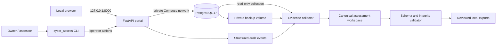

# Architecture

## Purpose and boundaries

The product has two deliberately separate planes:

- The **lab plane** is a FastAPI/Jinja portal and PostgreSQL database containing only synthetic
  business records. It produces application events and backup material.
- The **assessment plane** is a local CLI and versioned YAML/JSON workspace. It collects allowlisted
  read-only evidence, validates integrity, freezes snapshots, and creates one-way exports.

The portal image contains application source only. It does not mount `assessment/`, `outputs/`, or
`portfolio/`, so a compromised portal process cannot rewrite conclusions or published artifacts.

## Trust boundaries

| Boundary | Enforcement | Verification |
| --- | --- | --- |
| Host to portal | Compose publishes only `127.0.0.1:8000` | Inspect `docker compose config` and listening endpoints |
| Host to database | Database service has no `ports` entry | Compose-model CI job |
| Portal to database | Dedicated private Docker network and application credential | Integration tests and effective configuration review |
| Collection to source | Allowlisted fields and read-only collection role | Mutation-negative test and evidence manifest review |
| Runtime to assessment | No assessment workspace mounted in the app container | Image/Compose inspection |
| Assessment to export | Frozen snapshot, hash verification, atomic export | Tampering and interrupted-export tests |

## Container posture

The application runs as numeric UID/GID `10001`, drops Linux capabilities, enables
`no-new-privileges`, uses a read-only root filesystem, and receives writable storage only for the
named runtime volume and constrained `/tmp`. PostgreSQL persists in a Docker named volume rather
than a OneDrive-synchronized directory. Runtime secrets are injected from ignored `.env`; they are
not copied into image layers.

The Compose network is `internal`. Docker can still publish the explicit loopback application port
to the host, while containers on the network do not receive external routing. PostgreSQL remains
reachable only by service name from that network.

## Module responsibilities

| Module | Responsibility |
| --- | --- |
| `bank_lab` | Web routes, authentication, authorization, workflows, sessions, events, alerts, and health |
| `cyber_assess` | CLI, schemas, collection, integrity validation, snapshots, scenarios, and exports |
| `assessment/` | Human-reviewable canonical engagement, control, mapping, finding, action, and review records |
| `fixtures/` | Deterministic synthetic populations and expected scenario manifests |
| `runtime/` | Ignored secrets, raw evidence, backups, and execution state |
| `outputs/` | Ignored generated workbooks, reports, and slides pending review |
| `portfolio/` | Ignored, explicitly sanitized distribution candidate |

## Decision records

- [ADR-0001: architecture baseline](decisions/0001-architecture-baseline.md)
- [ADR-0002: evidence boundary](decisions/0002-evidence-boundary.md)
- [ADR-0003: local containment](decisions/0003-local-containment.md)
